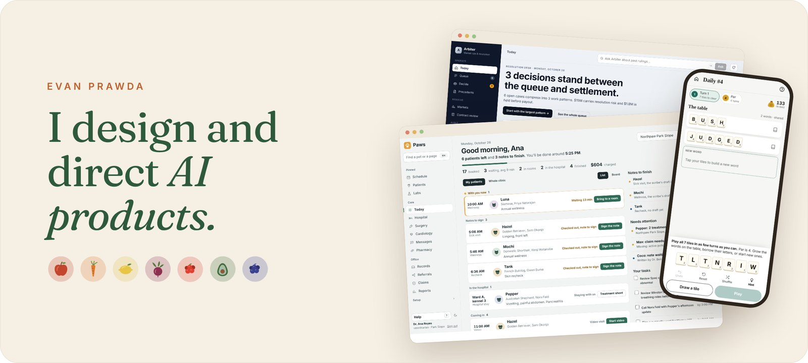
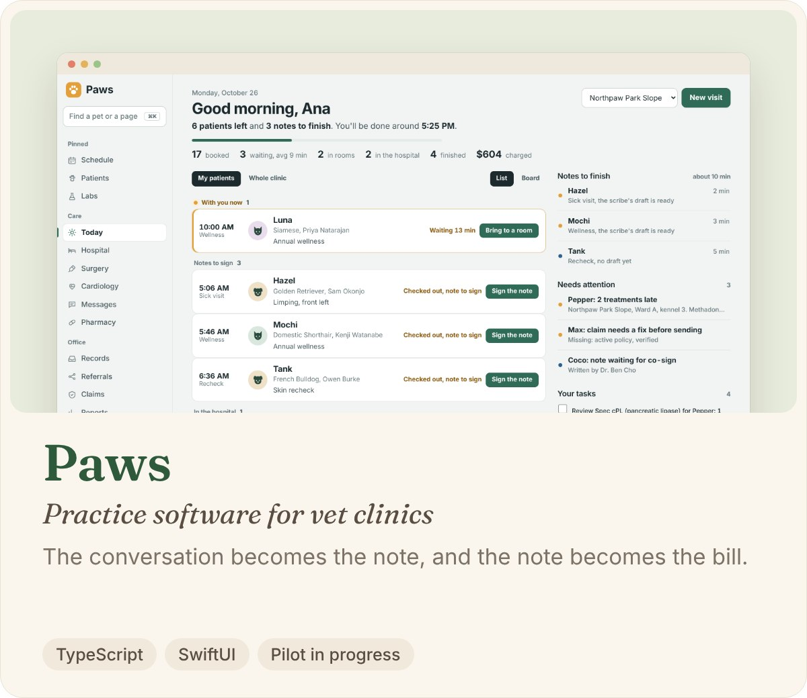
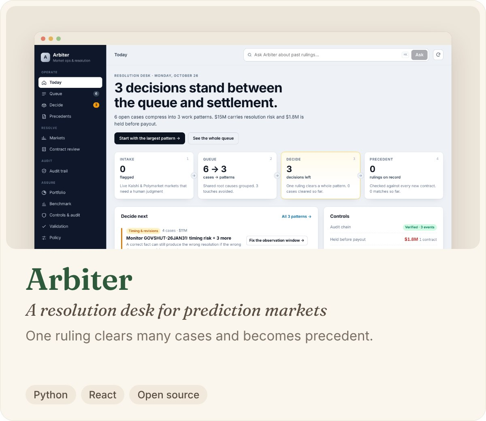
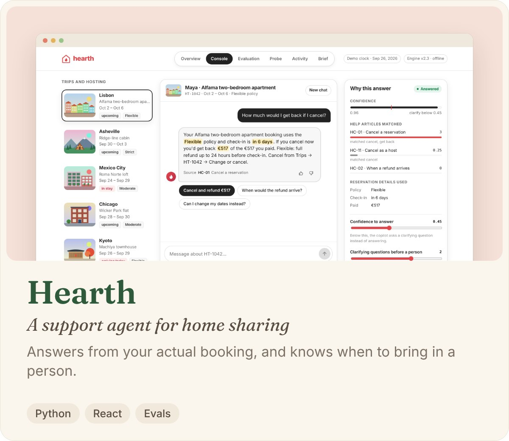

<picture>
  <source media="(prefers-color-scheme: dark)" srcset="assets/v2/hero-dark.jpg">
  
</picture>

 

<picture><source media="(prefers-color-scheme: dark)" srcset="assets/v2/paws-dark.jpg"></picture>
<picture><source media="(prefers-color-scheme: dark)" srcset="assets/v2/marche-dark.jpg"></picture>

<a href="https://wordish.evanprawda.workers.dev"><picture><source media="(prefers-color-scheme: dark)" srcset="assets/v2/wordish-dark.jpg"></picture></a>
<a href="https://github.com/ev-prawda92/arbiter"><picture><source media="(prefers-color-scheme: dark)" srcset="assets/v2/arbiter-dark.jpg"></picture></a>

<a href="https://github.com/ev-prawda92/hearth"><picture><source media="(prefers-color-scheme: dark)" srcset="assets/v2/hearth-dark.jpg"></picture></a>
<picture><source media="(prefers-color-scheme: dark)" srcset="assets/v2/concord-dark.jpg"></picture>

 

**Earlier** · Led Velocity from v0 to v1 at Veda, live at five health insurers · Co-founded Kilter Rewards, acquired by Blackbaud

<b>Sketchbook</b> · quicker studies

 

[Cortex](https://github.com/ev-prawda92/cortex) · [Ledgerline](https://github.com/ev-prawda92/ledgerline) · [Halflife](https://github.com/ev-prawda92/Halflife) · [Threshold](https://github.com/ev-prawda92/threshold) · [Horizon-Decay](https://github.com/ev-prawda92/Horizon-Decay) · [Equity Lens](https://github.com/ev-prawda92/Equity-Lens) · [Adrian](https://github.com/ev-prawda92/Adrian) · [Cortex Learning](https://github.com/ev-prawda92/cortexlearning) · [Sendero](https://github.com/ev-prawda92/Sendero) · [Quant](https://github.com/ev-prawda92/Quant)

 

Potter, writer, former line cook · Made with AI coding tools; every repo says so · [LinkedIn](https://www.linkedin.com/in/evanprawda) · evanprawda92@gmail.com
